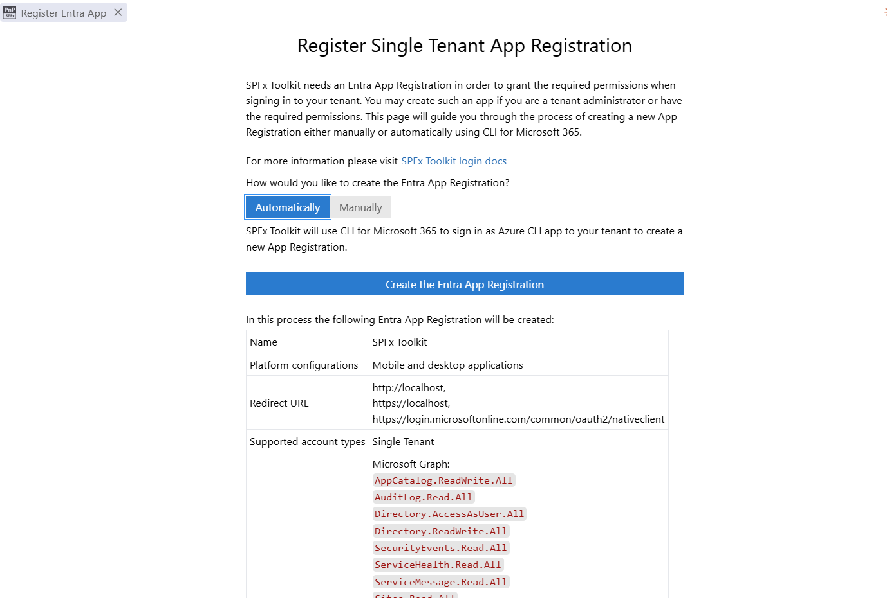
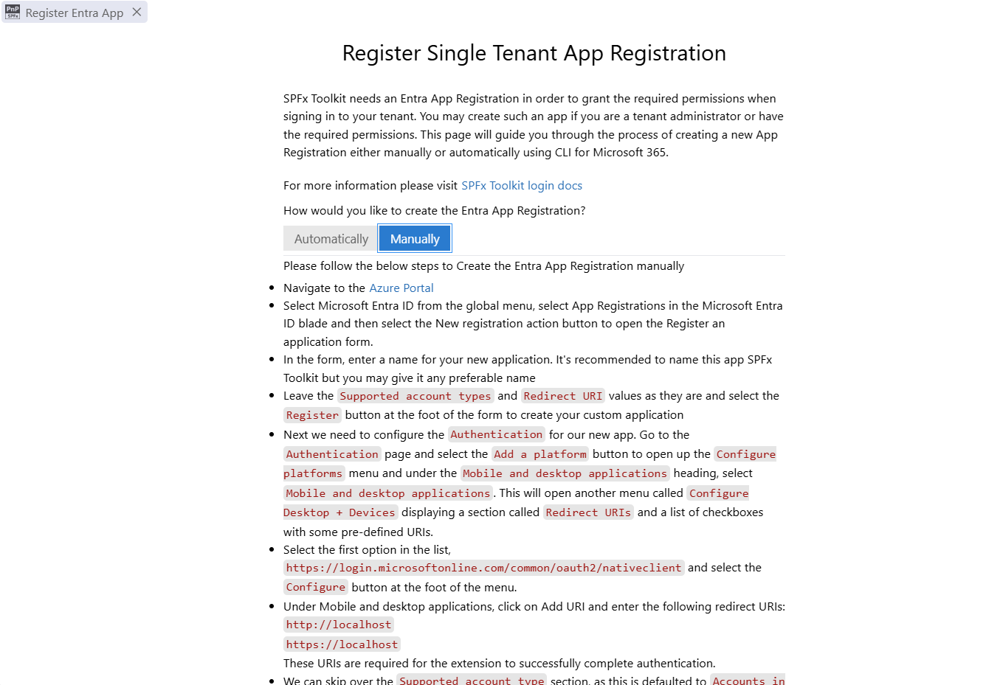
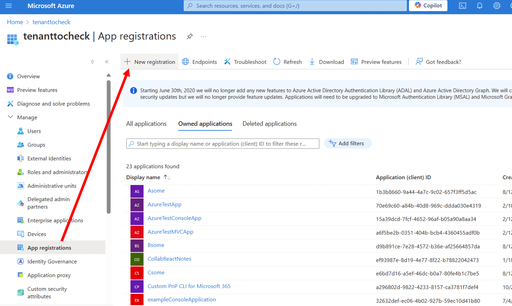
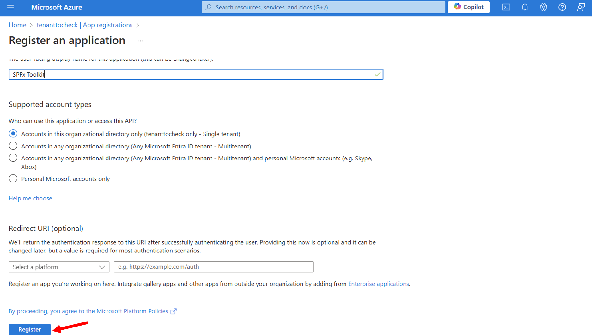
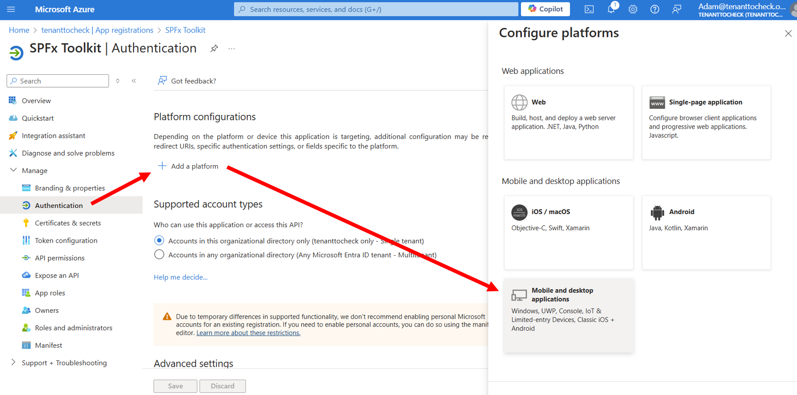
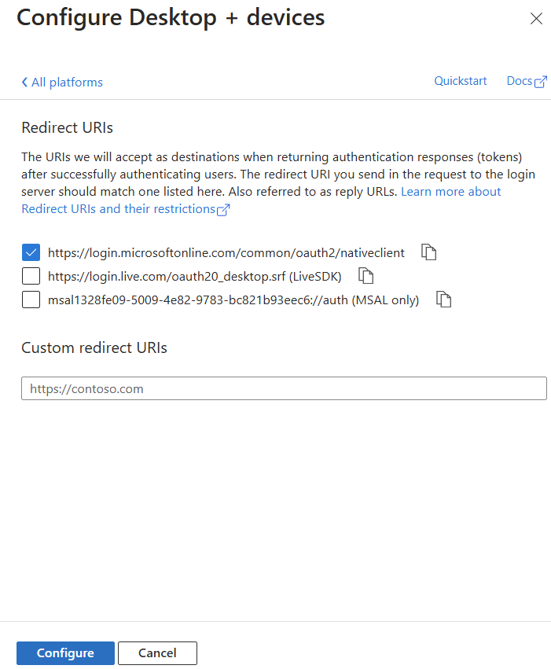
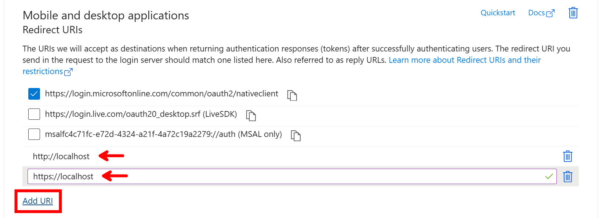
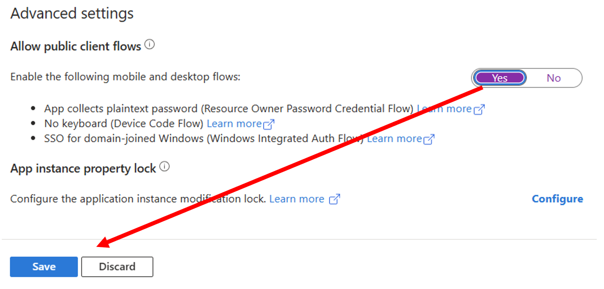
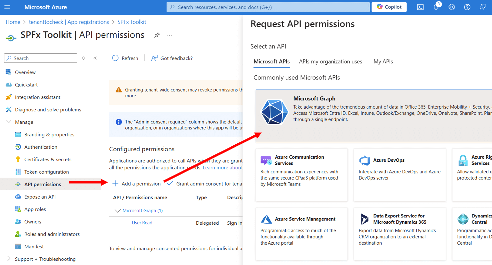

SPFx Toolkit needs an Entra App Registration to be able to sign in to your tenant. You may either create a new one with a single click or perform the manual setup in the Azure Portal. This is required only one time on each tenant, after that you may reuse the same app registration every time you [sign in](../sign-in).

If possible it is recommended to use the [automated way](#automatic-setup-recommended) to set up the SPFx Toolkit App Registration. Otherwise please follow the [manual steps](#manual-setup) to perform it manually.

## Automatic setup (recommended)

- Start the [sign-in process](../sign-in) and select <code>Create a new App Registration</code>
- SPFx Toolkit will open a dedicated form showing the app registration that will be created for you

- Start the creation and sign in to your tenant using the web browser that just has been opened
- SPFx Toolkit will create the <code>SPFx Toolkit</code> app registration in your tenant and grant admin consent for the [required permissions](#required-permissions)
- Once the app registration is created you may provide a friendly name for it and SPFx Toolkit will store that in [extension settings](../settings). That way when you will sign in again you may just pick it from the list of saved app registrations
- SPFx Toolkit will then sign you in to your tenant using the new app registration

In this process the following Entra App Registration will be created:

| Setting | Value |
| --- | --- |
| Name | `SPFx Toolkit` |
| Platform configurations | Mobile and desktop applications |
| Redirect URIs | `http://localhost` `https://localhost` `https://login.microsoftonline.com/common/oauth2/nativeclient` |
| Supported account types | Single tenant |
| Allow public client flows | Yes |
| API permissions | See [Required permissions](#required-permissions) |

## Manual setup

If you are not able to use the automated way, for example when your organization requires a different name for the app registration, you may perform the setup manually. SPFx Toolkit will also guide you through the manual steps when you select <code>Create a new App Registration</code> and pick the manual option.

- Navigate to the [Azure Portal](https://portal.azure.com/)
- Select Microsoft Entra ID from the global menu, select App Registrations in the Microsoft Entra ID blade and then select the New registration action button to open the Register an application form.

- In the form, enter a name for your new application. It's recommended to name this app SPFx Toolkit but you may give it any preferable name
- Leave the <code>Supported account types</code> and <code>Redirect URI</code> values as they are and select the <code>Register</code> button at the foot of the form to create your custom application

- Next we need to configure the <code>Authentication</code> for our new app. Go to the <code>Authentication</code> page and select the <code>Add a platform</code> button to open up the <code>Configure platforms</code> menu and under the <code>Mobile and desktop applications</code> heading, select <code>Mobile and desktop applications</code>. This will open another menu called <code>Configure Desktop + Devices</code> displaying a section called <code>Redirect URIs</code> and a list of checkboxes with some pre-defined URIs.

- Select the first option in the list, <code>https://login.microsoftonline.com/common/oauth2/nativeclient</code> and select the <code>Configure</code> button at the foot of the menu.

- Under Mobile and desktop applications, click on Add URI and enter the following redirect URIs:
    - http://localhost
    - https://localhost

- We can skip over the <code>Supported account type</code> section, as this is defaulted to <code>Accounts in this organizational directory only (tenant only - Single tenant)</code> meaning, that only users within the current tenant directory can use this application.
- In the <code>Advanced settings</code> section, we need to enable the <code>Allow public client flows</code> toggle, as we are using the <code>Device code flow</code> method to authenticate to our tenant using the CLI for Microsoft 365.

- To make sure all these changes are applied, select the <code>Save</code> button before moving on.
- Now that we have configured the application to work with the SPFx Toolkit, we next need to grant the required permissions. Select the <code>API permissions</code> in the menu option.

You will see a section called <code>Configured permissions</code> with one permission already granted. This is the default permission which allows the application to sign in the user account used when authenticating to the Microsoft Graph.

- Next select <code>Add a permission</code> and add all the delegated permissions listed in the [Required permissions](#required-permissions) section
- Select <code>Grant admin consent for &lt;your tenant&gt;</code> and confirm. This requires an account with admin rights, check the [Admin consent](#admin-consent) section for more details
- Go to <code>Overview</code> page and note down the <code>Application (client) ID</code> and <code>Directory (tenant) ID</code>
- Click on the <code>Sign in to Microsoft 365</code>, select <code>Sign in using existing App Registration</code> and provide the noted down <code>Client Id</code> and <code>Tenant Id</code>. Learn more in [Sign in](../sign-in)

## Required permissions

SPFx Toolkit requires the following delegated permissions. The same permissions are used both in the automated and the manual setup.

| API | Delegated permissions |
| --- | --- |
| Microsoft Graph | `AppCatalog.ReadWrite.All` `AuditLog.Read.All` `Directory.AccessAsUser.All` `Directory.ReadWrite.All` `SecurityEvents.Read.All` `ServiceHealth.Read.All` `ServiceMessage.Read.All` `Sites.Read.All` `User.Read` |
| Azure Active Directory Graph | `Directory.AccessAsUser.All` |
| Azure Service Management | `user_impersonation` |
| Office 365 Management APIs | `ActivityFeed.Read` `ServiceHealth.Read` |
| SharePoint | `AllSites.FullControl` `User.ReadWrite.All` |

Although it is not recommended, it is possible to use fewer permissions than the ones required by the SPFx Toolkit, but in that case, some features may not work as expected or at all. Learn more in [Technical insights](../../technical-insights).

## Admin consent

The required permissions need tenant-wide admin consent. That is why both the automated and the manual setup should be performed with an account that is able to create app registrations and grant admin consent, for example a Global Administrator or Privileged Role Administrator. Learn more in [Grant tenant-wide admin consent to an application](https://learn.microsoft.com/entra/identity/enterprise-apps/grant-admin-consent).