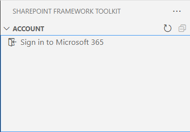
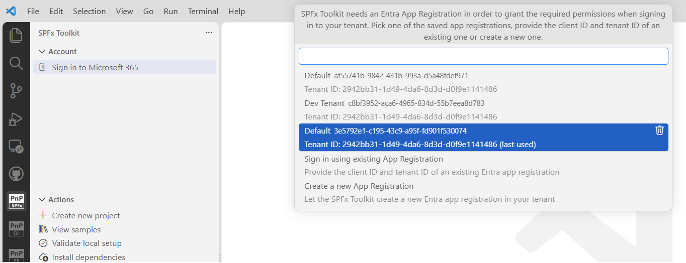

SharePoint Framework Toolkit requires you to sign in to your Microsoft 365 tenant to be able to perform some actions like deploying solutions to the tenant or site-level app catalog, managing app catalogs, and more.

:::note[Prerequisite]
SPFx Toolkit signs in using an Entra App Registration in your tenant. You need to set it up only once per tenant. If you don't have one yet, see [Entra App Registration](../entra-app-registration).
:::

## Start the sign-in

To sign in to your tenant, open SPFx Toolkit in the context of a SharePoint Framework project. In the account panel, select the `Sign in to Microsoft 365` button to start the process.

Alternatively, you may use the `>SPFx Toolkit: Sign in to Microsoft 365` command to do the same.

## Choose an app registration

SPFx Toolkit shows a list where you choose the app registration to sign in with.

- **Saved app registrations**: the app registrations you used before. The last used one is selected by default. Pick one to sign in again without providing the IDs.
- **Sign in using existing App Registration**: provide the `Application (client) ID` and the `Directory (tenant) ID` of an existing Entra app registration. Then optionally provide a friendly name, for example `Contoso dev tenant`, to easily recognize the app registration later.
- **Create a new App Registration**: let SPFx Toolkit create a new Entra app registration in your tenant. Learn more in [Entra App Registration](../entra-app-registration).

SPFx Toolkit then signs you in to Microsoft 365 using the selected app registration.

## Manage saved app registrations

Each time you sign in with a new app registration, SPFx Toolkit saves it in the extension settings, so you can easily sign in again or switch between multiple tenants.

To remove an app registration from the list, select the trash icon next to it and confirm. This only removes the app registration from the list. It doesn't delete the app registration from your tenant.

Learn more about the saved app registrations in [Settings](../settings).
